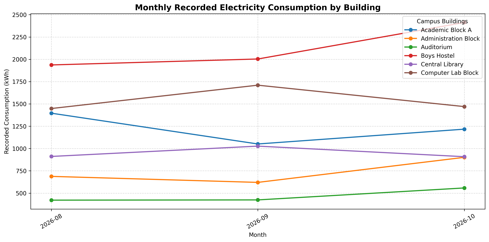
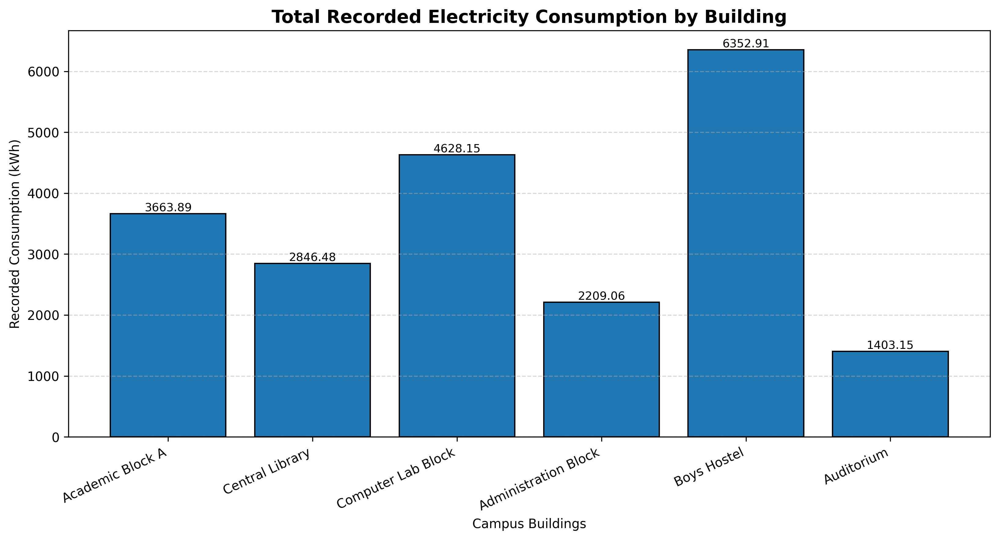

# ⚡ Campus Energy-Use Analyser

### A Python-Based Electricity Consumption Analysis and Visualization System


---

## 📌 1. Project Overview

The **Campus Energy-Use Analyser** is a Python-based data analysis application designed to analyse electricity consumption across different campus buildings.

The system processes electricity meter readings, maintains building records, identifies potentially abnormal consumption patterns, calculates energy statistics, generates monthly summaries, and visualizes electricity usage trends.

It integrates Python programming fundamentals with object-oriented programming, data structures, file handling, NumPy, Pandas, and Matplotlib to create a complete data analysis solution.

The project uses a simulated electricity consumption dataset representing six campus buildings. It demonstrates how data analysis techniques can help understand consumption patterns, compare building usage, and identify readings that require further investigation.

**Note:** The dataset contains simulated readings and does not represent actual electricity meter data from a university campus.

---

## 🎯 2. Project Objectives

- Analyse electricity consumption across multiple campus buildings.
- Maintain and manage electricity meter records.
- Identify potentially abnormal electricity consumption readings.
- Calculate total consumption and moving averages using NumPy.
- Generate monthly electricity consumption summaries using Pandas.
- Export analytical reports in JSON format.
- Visualize electricity consumption patterns using Matplotlib.
- Compare electricity usage between different campus buildings.
- Apply Python programming concepts in an integrated real-world-style application.

---

## 🚀 3. Key Features

### 📊 Data Analysis
- Calculate total electricity consumption.
- Analyse building-wise electricity usage.
- Calculate moving averages.
- Generate monthly consumption summaries.

### ⚠️ Abnormal Reading Detection
- Identify unusually high electricity consumption readings.
- Compare current readings with previous observations.
- Flag potentially abnormal consumption patterns for investigation.

### 🏢 Building Record Management
- Add new electricity meter records.
- Search records using record ID or building name.
- Update existing meter records.
- Delete records with confirmation.
- Validate records before storing them.

### 📈 Data Visualization
- Monthly electricity consumption trends.
- Building-wise consumption comparison.
- Automatically generate and save graphs.

### 📁 Report Generation
- Export analytical summaries into JSON.
- Store generated graphs in the graphs directory.
- Maintain structured CSV records.

---

## 🛠️ 4. Technology Stack

| Technology | Purpose |
|---|---|
| Python | Core programming language |
| NumPy | Numerical calculations and moving averages |
| Pandas | Data processing and monthly summaries |
| Matplotlib | Data visualization and graph generation |
| CSV | Dataset storage and record management |
| JSON | Analytical report export |
| Object-Oriented Programming | Meter record management |
| Git & GitHub | Version control and project hosting |
| Visual Studio Code | Development environment |

---

## 📂 5. Project Structure

```text
Campus-Energy-Use-Analyser/
│
├── data/
│   └── campus_energy_records.csv
│
├── graphs/
│   ├── building_consumption_comparison.png
│   └── monthly_energy_trends.png
│
├── reports/
│   └── energy_analysis_report.json
│
├── src/
│   ├── __init__.py
│   ├── models.py
│   ├── data_manager.py
│   ├── validation.py
│   ├── analysis.py
│   └── visualization.py
│
├── tests/
│   ├── data_quality_test_cases.csv
│   ├── test_project.py
│   └── test_record_management.py
│
├── generate_dataset.py
├── main.py
├── README.md
├── requirements.txt
└── .gitignore
```

### Module Description

| File / Module | Responsibility |
|---|---|
| `main.py` | Main application and interactive menu |
| `models.py` | Defines the MeterRecord class |
| `data_manager.py` | CSV loading, saving and record management |
| `validation.py` | Data validation and abnormal reading detection |
| `analysis.py` | NumPy calculations and Pandas summaries |
| `visualization.py` | Generates electricity consumption graphs |
| `generate_dataset.py` | Generates the simulated dataset |
| `test_project.py` | Tests core project functionality |
| `test_record_management.py` | Tests record management operations |
| `data_quality_test_cases.csv` | Contains sample data quality test cases |

---

## 📊 6. Dataset Information

The project uses a simulated electricity consumption dataset containing **90 records** across six campus buildings.

### Dataset Specifications

| Attribute | Details |
|---|---|
| Dataset Type | Simulated electricity consumption data |
| Total Records | 90 |
| Number of Buildings | 6 |
| Observations per Building | 15 |
| Start Date | 01 August 2026 |
| End Date | 25 October 2026 |
| File Format | CSV |
| Storage Location | `data/campus_energy_records.csv` |

### Campus Buildings

| Building ID | Building Name | Meter ID |
|---|---|---|
| B001 | Academic Block A | MTR001 |
| B002 | Central Library | MTR002 |
| B003 | Computer Lab Block | MTR003 |
| B004 | Administration Block | MTR004 |
| B005 | Boys Hostel | MTR005 |
| B006 | Auditorium | MTR006 |

### Dataset Attributes

The dataset contains the following columns:

- `record_id` – Unique identification for each meter reading.
- `building_id` – Unique identification of the campus building.
- `building_name` – Name of the building.
- `meter_id` – Electricity meter identification.
- `reading_date` – Date of the electricity reading.
- `consumption_kwh` – Electricity consumption measured in kilowatt-hours.

### Dataset Generation

The project includes a Python script to generate the simulated dataset.

```bash
python generate_dataset.py
```

**Note:** Running the generator again may replace the existing dataset.

---

## ⚙️ 7. Installation and Setup

### Prerequisites

- Python 3.11 or later
- pip package manager
- Visual Studio Code or another Python-compatible IDE
- Git

### Step 1: Clone the Repository

```bash
git clone https://github.com/sahil6000/Campus-Energy-Use-Analyser.git
```

### Step 2: Navigate to the Project Directory

```bash
cd Campus-Energy-Use-Analyser
```

### Step 3: Install Dependencies

```bash
python -m pip install -r requirements.txt
```

### Step 4: Verify Library Installation

```bash
python -c "import numpy, pandas, matplotlib; print('All libraries installed successfully')"
```

### Step 5: Run the Application

```bash
python main.py
```

---

## 🖥️ 8. Application Menu

The application provides an interactive, menu-driven interface with 12 operations.

### DATA ANALYSIS

| Option | Operation |
|---|---|
| 1 | View Dataset Summary |
| 2 | View Building Consumption |
| 3 | View Abnormal Readings |
| 4 | View Monthly Energy Summary |

### RECORD MANAGEMENT

| Option | Operation |
|---|---|
| 5 | Add New Meter Record |
| 6 | Search Meter Record |
| 7 | Update Meter Record |
| 8 | Delete Meter Record |

### REPORTS & VISUALIZATION

| Option | Operation |
|---|---|
| 9 | Generate Electricity Usage Graphs |
| 10 | Export JSON Report |
| 11 | Run Complete Analysis |
| 12 | Exit |

---

## 🧮 9. Analytical Methodology

### 9.1 Total Electricity Consumption

The system calculates the total recorded electricity consumption across all campus buildings.

\[
\text{Total Consumption} = \sum_{i=1}^{n} C_i
\]

Where:

- \(C_i\) represents the electricity consumption of an individual reading.
- \(n\) represents the total number of readings.

### 9.2 Building-Wise Consumption

The system groups electricity readings by building and calculates the total recorded consumption for each building.

This helps compare energy usage between different campus facilities.

### 9.3 Moving Average

NumPy is used to calculate moving averages for electricity consumption observations.

A three-observation moving average is calculated using:

\[
MA_3 = \frac{C_{n-1}+C_{n-2}+C_{n-3}}{3}
\]

Where the previous three observations are used to calculate the average.

### 9.4 Abnormal Reading Detection

The system identifies potentially abnormal readings by comparing current consumption against the moving average.

These readings are flagged for further investigation rather than automatically classified as confirmed faults or energy wastage.

### 9.5 Monthly Energy Summary

Pandas is used to organize readings by month and building and calculate monthly consumption summaries.

Since the dataset contains five sampled observations per building per month, the monthly totals represent the sum of those sampled readings, not complete-month electricity consumption.

### 9.6 JSON Report Export

The system exports analytical results into a structured JSON file for easy storage and sharing.

---

## 📈 10. Data Visualization

The project generates two major visualizations using Matplotlib.

### 10.1 Monthly Energy Consumption Trends

This graph represents the recorded electricity consumption trends across campus buildings over the selected months.



### 10.2 Building-Wise Consumption Comparison

This graph compares the total recorded electricity consumption across the six campus buildings.



Both visualizations are automatically generated and saved inside the `graphs/` directory.

---

## 📋 11. Analysis Results

The following results were obtained from the simulated dataset during project execution.

### Overall Dataset Results

| Metric | Result |
|---|---:|
| Total Records | 90 |
| Valid Records | 90 |
| Invalid Records | 0 |
| Total Recorded Consumption | 21,103.64 kWh |
| Moving Average Observations | 78 |
| Potentially Abnormal Readings | 7 |

### Building-Wise Consumption Results

| Building | Total Recorded Consumption |
|---|---:|
| Academic Block A | 3,663.89 kWh |
| Central Library | 2,846.48 kWh |
| Computer Lab Block | 4,628.15 kWh |
| Administration Block | 2,209.06 kWh |
| Boys Hostel | 6,352.91 kWh |
| Auditorium | 1,403.15 kWh |

### Key Observations

- Boys Hostel recorded the highest total electricity consumption.
- Auditorium recorded the lowest total electricity consumption.
- Computer Lab Block also showed comparatively high electricity usage.
- Seven readings were flagged as potentially abnormal and require further investigation.
- All 90 records passed the reported dataset validation checks.

**Interpretation:** These findings are based on simulated and sampled readings. They should not be treated as actual campus energy consumption measurements or complete monthly electricity bills.

---

## 🧪 12. Testing and Validation

Testing is included to verify the functionality and reliability of the application.

### Testing Coverage

- Dataset loading and processing.
- Record validation.
- Missing value handling.
- Negative consumption validation.
- Duplicate record identification.
- Invalid date handling.
- Record addition.
- Record searching.
- Record updating.
- Record deletion.
- Data management operations.

### Run the Test Suite

Execute the following command from the project root directory:

```bash
python -m unittest discover -s tests -p "test_*.py" -v
```

The test framework uses Python's built-in `unittest` module.

---

## 🎓 13. Course Outcome Mapping

| Course Outcome | Implementation in Project |
|---|---|
| CO1 – Programming Fundamentals | Functions, conditions, loops and procedural programming |
| CO2 – Data Structures and File Handling | Lists, dictionaries, CSV reading and writing |
| CO3 – Object-Oriented Programming | MeterRecord class and special methods |
| CO4 – NumPy | Numerical calculations, totals and moving averages |
| CO5 – Pandas | DataFrames, monthly summaries and JSON export |
| CO6 – Data Visualization | Matplotlib graphs and analytical interpretation |

---

## 🧠 14. Bloom's Taxonomy Mapping

| Level | Project Implementation |
|---|---|
| BL2 – Understand | Understanding electricity consumption data and analytical concepts |
| BL3 – Apply | Applying Python, NumPy, Pandas and Matplotlib |
| BL4 – Analyse | Analysing consumption patterns and abnormal readings |
| BL5 – Evaluate | Comparing buildings and interpreting energy usage |
| BL6 – Create | Developing an integrated campus energy analysis application |

---

## 📁 15. Generated Output Files

The application generates and maintains the following output files:

| Output File | Description |
|---|---|
| `campus_energy_records.csv` | Electricity meter records |
| `monthly_energy_trends.png` | Monthly consumption visualization |
| `building_consumption_comparison.png` | Building-wise comparison graph |
| `energy_analysis_report.json` | Structured analytical report |

---

## 🔮 16. Future Enhancements

The project can be extended with additional features:

- Real-time electricity meter integration.
- Interactive web-based analytics dashboard.
- Building-wise electricity cost estimation.
- Carbon emission estimation.
- Advanced anomaly detection algorithms.
- Electricity consumption forecasting.
- Automated energy efficiency recommendations.
- Database integration for large-scale record management.

---

## 👨‍💻 17. Project Information

**Project Name:** Campus Energy-Use Analyser

**Project Type:** Python-Based Data Analysis Application

**Programming Language:** Python

**Development Environment:** Visual Studio Code

**Dataset:** Simulated Campus Electricity Consumption Data

**Repository:** [GitHub - Campus Energy-Use Analyser](https://github.com/sahil6000/Campus-Energy-Use-Analyser)

---

## 📜 18. Disclaimer

This project is developed for academic and educational purposes.

The electricity consumption dataset is simulated for demonstrating data analysis, record management, anomaly detection, numerical computation, and data visualization techniques.

The identified abnormal readings are potential indicators for further investigation and do not confirm actual electrical faults or energy wastage.

---

<p align="center">
  <b>Campus Energy-Use Analyser</b><br>
  Transforming Electricity Readings into Meaningful Insights ⚡
</p>
